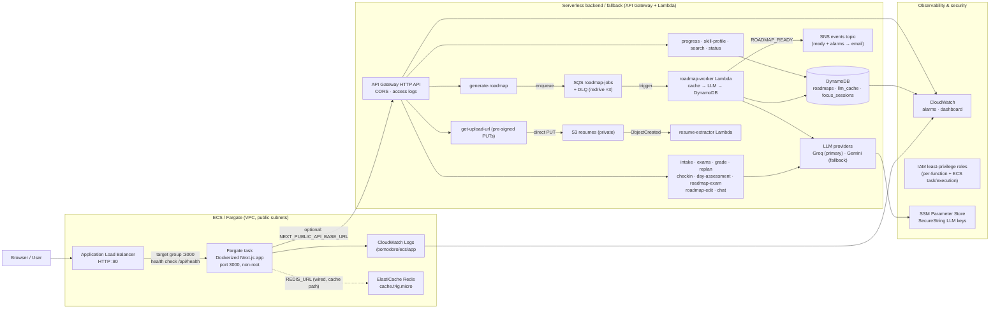

# Pomodoro Dashboard

**Pomodoro Dashboard** is an AI-powered productivity, learning-planning, roadmap and study-assistant platform. It combines a classic Pomodoro focus timer with task management, per-task monitoring, AI-generated learning roadmaps, assessments and quizzes, persistent skill profiles, a data-grounded **Study Assistant** chat ("RAG over your own tracked progress"), and resume/file upload that lets the AI infer your level before building a plan.

The application is a Next.js 14 application deployed to **Amazon ECS / Fargate** behind an **Application Load Balancer (ALB)**, served from a **Docker image** in **Amazon ECR**. The repository also contains a full **serverless backend/fallback architecture** (API Gateway + Lambda + DynamoDB + S3 + SQS + SNS) that the frontend can route to as its API backend.

## Live Demo

The current live deployment is reached through the public ALB endpoint:

```
http://pomodoro-dashboard-alb-1223371936.us-east-1.elb.amazonaws.com
```

> ⚠️ The live demo is served over **plain HTTP** — TLS/HTTPS (ACM + custom domain) is not yet configured on this ALB.

## What the Project Does

Everything below is functionality implemented in this repository and served by the running app:

- **Task management** — create, edit, prioritise, estimate and complete daily tasks (`lib/`, `components/TaskManager.tsx`, `components/CreateTaskModal.tsx`).
- **Pomodoro / focus timer** — a 25-min work / short-break / long-break timer that ties into the active task and logs focus sessions (`components/Timer.tsx`, `hooks/usePomodoro.ts`).
- **Task monitoring** — per-task progress tracking across days/steps/time spent, derived purely from the persisted task records (`lib/monitoring.ts`, `components/MonitoringPanel.tsx`).
- **Roadmaps** — day-by-day structured learning roadmaps (1/3/7-day plans) generated by an LLM (`lib/llm.ts`, `lib/task-roadmap.ts`, `components/TopicBoard.tsx`).
- **AI-generated learning plans** — an adaptive **intake conversation** collects goal, time budget, skill level, deadline and constraints (and optional resume text) before the roadmap is tailored to the user (`lib/llm.ts` intake, `components/IntakeFlow.tsx`).
- **AI quick-check questions** — a short multiple-choice check-in after each completed learning step to verify comprehension (`lib/ai.ts` `/api/generate-checkin`, `components/CheckInModal.tsx`).
- **Assessments / tests** — per-task quizzes, end-of-day assessments, and a roadmap-level mock exam, all generated and graded by the LLM (`/api/generate-exam`, `/api/grade-exam`, `/api/generate-day-assessment`, `/api/generate-roadmap-exam`).
- **Progress tracking** — durable, revision-guarded progress documents, activity heatmap, streaks, weekly trend and pace insights (`lib/progress-sync.ts`, `lib/activity.ts`, `lib/insights.ts`, `app/api/progress`).
- **Skill profiles** — a rolling, per-topic skill score built from check-in and exam evidence, persisted and synced server-side (`lib/skills.ts`, `app/api/skill-profile`).
- **Study Assistant / RAG** — a floating chat that answers about **your actual tracked learning data**, rebuilt server-side from the authoritative progress store on every message (`app/api/chat`, `lib/learning-data.ts`, `components/AssistantChat.tsx`).
- **Search** — substring search over generated roadmaps by topic (`roadmap-search` Lambda, `lib/dashboard-stats.ts`).
- **Resume / file upload & extraction** — upload a `.txt/.md/.csv/.pdf/.docx` resume via pre-signed S3 PUTs; a Lambda extracts the text and feeds it into the intake flow (`get-upload-url` + `resume-extractor` Lambdas).
- **AI / LLM integration** — every AI feature routes through a single provider layer (`lib/llm.ts`, `infrastructure/lambda-src/shared/llm.mjs`) with a primary → fallback provider and strict JSON validation.

## Key Features

- **Adaptive AI intake** before plan generation (goal, daily time budget, level, deadline, constraints, optional resume).
- **1 / 3 / 7-day learning roadmaps** with per-day tasks, time estimates, curated references and search links.
- **Re-planning** — a full day's task list is re-fit into your stated daily time budget with one click.
- **AI-graded knowledge checks** — per-step check-ins, per-task quizzes, day assessments and a roadmap mock exam.
- **Real, evidence-based skill profiles** that never reset per roadmap.
- **A grounded Study Assistant** that answers from your saved tasks, roadmaps, scores and session history — it never invents progress.
- **Focus + productivity analytics** — heatmap, streaks, weekly trend, best-day and roadmap-pace insights.
- **Resume upload** that jump-starts plan personalisation.
- **PWA** — offline caching via a service worker and a web-app manifest (`public/sw.js`, `app/manifest.ts`).

## Architecture

The repository contains **two real, coexisting deployment paths**:

1. **Container path (current live demo)** — the Dockerized Next.js application runs on **ECS/Fargate** inside a VPC and is exposed to the internet through a public **Application Load Balancer**. The image is stored in **ECR**. In this mode the Next.js route handlers under `app/api/*` serve the API (the image is built with a blank `NEXT_PUBLIC_API_BASE_URL`, i.e. "local mode").
2. **Serverless backend / fallback path** — a full **API Gateway (HTTP) + Lambda + DynamoDB + S3 + SQS + SNS** stack. When the frontend is built with `NEXT_PUBLIC_API_BASE_URL` set to the API Gateway URL, `lib/api.ts` routes browser calls to this backend instead (async roadmap generation through SQS, resume uploads to S3, progress/skill/chat endpoints in DynamoDB).

ECS/Fargate does **not** replace the Lambda/API Gateway backend — both are provisioned by the Terraform stack, and the frontend's `lib/api.ts` is the single switch between them.



**Key flows**

- **Async roadmap generation:** `POST /api/generate-roadmap` validates the input, stores a `PENDING` job in DynamoDB and enqueues an SQS message. The `roadmap-worker` Lambda consumes the message, checks the LLM response cache, calls the LLM, writes the roadmap + `READY` status in a single DynamoDB transaction, then publishes a `ROADMAP_READY` event to SNS. The frontend polls `GET /api/roadmap-status/{jobId}` until it is `READY`.
- **Resume uploads:** the browser gets a pre-signed S3 PUT URL, uploads the file directly to S3 (never through API Gateway), and an `ObjectCreated` event triggers the `resume-extractor` Lambda which writes `extracted/<key>.json` for the frontend to poll.
- **Study Assistant:** every chat message rebuilds the user's learning context server-side from the authoritative progress docs in DynamoDB (never a stale client snapshot) and sends it to the LLM with a grounding prompt.

## AWS Services Used

| Service | Purpose | How it is used | Path |
|---|---|---|---|
| **ECS / Fargate** | Container compute | Runs the Dockerized Next.js app (0.25 vCPU / 0.5 GB task, `awsvpc` network mode, public IP, ECS Exec enabled) | **ECS deployment** |
| **ALB** | Public front door | HTTP :80 listener → target group on container port 3000, health checks on `/api/health`; task SG only allows :3000 from the ALB SG | **ECS deployment** |
| **ECR** | Image registry | Private `pomodoro-dashboard-app` repository with a lifecycle policy (keep 5 tagged, expire untagged after 1 day) | **ECS deployment** |
| **S3** | Private resume storage | `pomodoro-dashboard-resumes-<account>` bucket; pre-signed PUTs under `uploads/*`, extracted text under `extracted/*`; public access blocked, SSE-S3, 30-day lifecycle | Serverless backend |
| **Redis / ElastiCache** | Cache layer | Single `cache.t4g.micro` node (Redis 7.1) wired into the ECS task via `REDIS_URL`; security group allows :6379 from ECS tasks only; slow-log shipped to CloudWatch | **ECS deployment** |
| **SNS** | Events + alerts | `pomodoro-dashboard-events` topic: "roadmap ready" domain events and the target for all CloudWatch alarms; optional email subscription | Serverless backend |
| **SQS + DLQ** | Async job queue | `roadmap-jobs` queue (visibility 180s, 4-day retention, redrive `maxReceiveCount=3`) + `roadmap-jobs-dlq` (14-day retention); worker uses `ReportBatchItemFailures` | Serverless backend |
| **IAM** | Least-privilege access | Per-Lambda roles assembled from a capability matrix; separate ECS **execution role** (ECR pull, logs, SSM) and **task role** (SSM, DynamoDB, S3, SQS send, SNS publish, ECS Exec); route-scoped API invoke permissions | Both |
| **CloudWatch** | Logs, alarms, dashboard | ECS app logs (7-day retention), per-Lambda log groups (7-day), API Gateway access logs, 4 alarms (worker errors, queue backlog, DLQ non-empty, API 5XX), one overview dashboard | Both |
| **Lambda** | Serverless compute | 18 functions on Node.js 20 / arm64 (LLM endpoints, async worker, progress, skill profiles, chat, search, uploads, extractor) | Serverless backend |
| **API Gateway** | HTTP API front for Lambdas | HTTP API v2 (`$default` stage, auto-deploy), Lambda-proxy integrations (payload 2.0), CORS configured on the gateway, access logs | Serverless backend |
| **DynamoDB** | State, cache, search | `roadmaps` (PK `user_id` / SK `sk`: `JOB#`, `ROADMAP#`, `PROGRESS#`, `SKILL#` items), `llm_cache` (TTL-based LLM response cache), `focus_sessions`; all provisioned 2 RCU / 2 WCU | Serverless backend |
| **SSM Parameter Store** | Secrets & config | `/pomodoro/config/llm_provider` (String) and `/pomodoro/secrets/groq_api_key`, `/pomodoro/secrets/gemini_api_key` (SecureString) | Both |
| **VPC** | Network isolation | `10.0.0.0/16` with 2 public subnets + Internet Gateway; no NAT, no private subnets (cost-optimised); security groups restrict Redis and ECS task ingress | **ECS deployment** |

## Docker

The `Dockerfile` builds a production image with a **multi-stage build**:

1. **`deps`** — `node:20-alpine`, installs all dependencies with `npm ci`.
2. **`builder`** — copies the source, runs `npm run build` with `output: "standalone"` (see `next.config.mjs`), producing a self-contained `.next/standalone` server.
3. **`runner`** — a minimal `node:20-alpine` runtime that copies only the standalone server, static assets and `public/`.

What the image actually does:

- **Production Next.js standalone build** — `next start` is replaced by `node server.js` from the `.next/standalone` output, so no `node_modules` are needed at runtime.
- **Non-root user** — the runner stage creates a `nextjs` system user (uid/gid 1001) and runs the server as `USER nextjs`.
- **Port 3000** — `EXPOSE 3000`, `PORT=3000`.
- **`HOSTNAME=0.0.0.0`** — set explicitly because the standalone server otherwise binds only the container's eth0 IP and rejects the localhost health check.
- **Health check** — `HEALTHCHECK` runs `wget --no-verbose --tries=1 --spider http://127.0.0.1:3000/api/health` (30s interval, 20s start period, 3 retries). The same probe is used by the ALB target group and `compose.yaml`.
- **Build argument `NEXT_PUBLIC_API_BASE_URL`** — a **public** URL (the API Gateway URL) that can be inlined into the client bundle at build time; blank keeps the image in local mode. Secrets are never baked into the image (see `.dockerignore`).

## Local Development

### Prerequisites

- **Node.js 20+** (the Dockerfile and Lambda runtime both use 20.x)
- **npm** (Node 20 ships with npm 10+)
- Optional: **Docker** + **Docker Compose** for the container path

### Install & run

```bash
# 1. Install dependencies
npm install

# 2. Create your environment file
cp .env.local.example .env.local

# 3. (Optional but needed for AI features) add your LLM keys
#    Edit .env.local and set your Groq and/or Gemini API key.

# 4. Start the dev server
npm run dev
# -> http://localhost:3000
```

Environment example (placeholders only — `.env.local` is gitignored and must never be committed):

```bash
# Choose the LLM provider: "grok" or "gemini"
LLM_PROVIDER=grok

# Groq API key (used when LLM_PROVIDER=grok)
GROQ_API_KEY=your_groq_api_key_here

# Gemini API key (used when LLM_PROVIDER=gemini)
GEMINI_API_KEY=your_gemini_api_key_here

# Optional: point the client at the deployed serverless backend
NEXT_PUBLIC_API_BASE_URL=https://your-api-gateway-url.execute-api.us-east-1.amazonaws.com
```

Without `.env.local`, the app still runs — every AI route shows a clear "API key is not set" error only when a feature that needs the LLM is used.

### Docker Compose

```bash
# Build and run the production image on :3000
docker compose up --build

# The compose file:
#   - builds from ./Dockerfile      (image: pomodoro-dashboard-app:latest)
#   - maps host :3000 -> container :3000
#   - runs with NODE_ENV=production, HOSTNAME=0.0.0.0, PORT=3000
#   - loads .env.local if present (env_file, required: false)
#   - runs the same /api/health healthcheck
```

`compose.yaml` loads runtime secrets from `.env.local` at run time — they stay out of the image.

## AWS Deployment

All infrastructure is defined as **Terraform** in `infrastructure/terraform/` and organised into numbered "phase" files. The stack provisions both the container path and the serverless backend:

| Phase file | What it provisions |
|---|---|
| `phase0-foundations.tf` | Identity data sources, SSM Parameter Store namespace (`/pomodoro/config`, `/pomodoro/secrets`) |
| `phase1-lambda-compute.tf` | 18 Lambda functions (Node.js 20, arm64), per-function IAM roles + log groups (from `locals.tf`) |
| `phase2-api-gateway.tf` | HTTP API (v2) with Lambda-proxy routes, CORS on the gateway, access logs |
| `phase3-resume-uploads.tf` | Private S3 bucket (public access blocked, SSE-S3, 30-day lifecycle) + extractor event notifications |
| `phase4-async-generation.tf` | SQS `roadmap-jobs` + DLQ, SQS→worker event source, SNS events topic + email subscription |
| `phase5-dynamodb.tf` | `roadmaps`, `llm_cache` (TTL), `focus_sessions` tables (provisioned 2/2) |
| `phase6-cloudwatch.tf`, `phase6-dashboard.tf` | 4 alarms (worker errors, queue backlog, DLQ, API 5XX) + overview dashboard |
| `phase7-ecr.tf` | Private ECR repository + lifecycle policy |
| `phase8-vpc.tf` | VPC (`10.0.0.0/16`), 2 public subnets, Internet Gateway, route tables |
| `phase9-ecs.tf` | ECS cluster, task SG (egress 443 only), ECS execution + task IAM roles |
| `phase9-ecs-task.tf` | Fargate task definition (0.25 vCPU / 0.5 GB) + ECS service with ALB registration |
| `phase10-alb.tf` | Public ALB, target group (health `/api/health`), HTTP :80 listener, SG rules |
| `phase12-redis.tf` | ElastiCache Redis (`cache.t4g.micro`, slow-log only) restricted to the ECS task SG |

Deployment steps (see `infrastructure/README.md` for the full reference):

```bash
# 1. Store LLM keys as SSM SecureStrings (keeps keys out of tfstate)
#    ./infrastructure/scripts/set-secrets.ps1 -GroqApiKey "..." [-GeminiApiKey "..."]

# 2. Provision the stack
cd infrastructure/terraform
terraform init
terraform apply   # set var.alert_email to subscribe the SNS email

# 3. Build + push the app image to ECR
#    (docker build --build-arg NEXT_PUBLIC_API_BASE_URL=... , then push the
#     tagged image to the ECR repository from terraform output ecr_repository_uri)

# 4. Point the frontend at the API (optional serverless mode)
#    NEXT_PUBLIC_API_BASE_URL = terraform output api_base_url

# 5. The ALB DNS name is published via terraform output alb_dns_name
```

**Deployment notes**

- The ECR image tag is controlled by `var.image_tag` (default `v1.0.1`) in `variables.tf`; the Fargate `desired_count` is configurable (set to `0` to stop Fargate billing when idle).
- `terraform.tfstate` / `terraform.tfstate.backup` are present in the working directory and gitignored; the recommended secret path is `set-secrets.ps1`, which writes to SSM without putting keys in state.
- No destructive commands are part of the normal deployment workflow.

## Project Structure

```
pomodoro-dashboard/
├─ app/                              # Next.js App Router (pages + route handlers)
│  ├─ (main)/                        # Dashboard shell (layout + landing page)
│  │  ├─ page.tsx                    #   main dashboard (timer, tasks, roadmaps, stats)
│  │  └─ task/
│  │     ├─ new/page.tsx             #   create-task flow
│  │     └─ [id]/page.tsx            #   per-task "workspace" (roadmap, monitoring)
│  ├─ api/                           # Next.js route handlers (local API mode)
│  │  ├─ chat/  generate-checkin/  generate-day-assessment/
│  │  ├─ generate-exam/  generate-roadmap/  generate-roadmap-exam/
│  │  ├─ grade-exam/  health/  intake/  learning-data/
│  │  ├─ progress/  replan-day/  roadmap-edit/  skill-profile/
│  ├─ architecture/page.tsx          # Static SVG architecture diagram page
│  ├─ layout.tsx  globals.css  manifest.ts  icon.svg
├─ components/                       # React UI (Timer, TaskManager, AssistantChat,
│  │                                 #   modals, habeet/ dashboard widgets, etc.)
├─ hooks/
│  └─ usePomodoro.ts                 # Central app state + effects (timer/tasks/sync)
├─ lib/                              # Business logic (no JSX)
│  ├─ llm.ts  ai.ts                  #   LLM provider layer (Groq/Gemini), AI helpers
│  ├─ api.ts                         #   client that switches local vs remote API
│  ├─ storage.ts  types.ts           #   localStorage schema + types
│  ├─ task-roadmap.ts  practice.ts   #   roadmap/practice-goal logic
│  ├─ monitoring.ts  learning-data.ts#   learning-data access (used by chat)
│  ├─ skills.ts  insights.ts         #   skill profiles, insights
│  ├─ progress-sync.ts
│  └─ progress-store-server.ts       #   server-side progress store (dev twin of DynamoDB)
├─ public/
│  └─ sw.js                          # Service worker (offline caching / PWA)
├─ scripts/                          # Verification/test scripts (puppeteer-based)
├─ infrastructure/
│  ├─ terraform/                     # All Terraform infrastructure (phase*.tf, state)
│  ├─ lambda-src/
│  │  ├─ functions/                  #   18 Lambda functions (index.mjs each)
│  │  └─ shared/                     #   aws.mjs, llm.mjs, respond.mjs, plan-rules.mjs
│  ├─ scripts/set-secrets.ps1        #   Stores LLM keys in SSM SecureString
│  ├─ test-payloads/                 #   Sample request payloads for manual Lambda tests
│  └─ README.md  PHASES-1-3.md  PHASES-4-6.md  INTERVIEW-TALKING-POINTS.md
├─ Dockerfile  compose.yaml  .dockerignore
├─ next.config.mjs  tailwind.config.ts  tsconfig.json
└─ package.json
```

## Environment Variables

Required environment variables **by name** (no values — see `.env.local.example` and `infrastructure/README.md` for placeholders). The preferred provider for AI features is **Groq** (default), with **Gemini** as the fallback.

### Client / public variables

| Variable | Purpose |
|---|---|
| `NEXT_PUBLIC_API_BASE_URL` | API Gateway URL the browser routes to; **blank/absent keeps the app in local mode** (Next.js route handlers). Inlined into the client bundle at build time — public, never a secret. |
| `NEXT_PUBLIC_DEMO` | Set to `"true"` to show the Demo Mode button in the UI. |
| `NEXT_TELEMETRY_DISABLED` | Disables Next.js telemetry (set in the Dockerfile). |

### Server-only variables

| Variable | Purpose |
|---|---|
| `LLM_PROVIDER` | `"grok"` or `"gemini"` — selects the active LLM provider. |
| `GROQ_API_KEY` | API key for the Groq provider (used when `LLM_PROVIDER=grok`). |
| `GEMINI_API_KEY` | API key for the Gemini provider (used when `LLM_PROVIDER=gemini`). |
| `GROQ_MODEL` / `GEMINI_MODEL` | Optional model overrides (defaults: `openai/gpt-oss-120b` / `gemini-3.6-flash` locally). |
| `DEMO_USER_ID` | Single-tenant user id for the progress store (default `demo-user`). |
| `REDIS_URL` | ElastiCache endpoint (`redis://<host>:6379`), wired into the ECS task definition. |
| `NODE_ENV`, `HOSTNAME`, `PORT` | Runtime settings for the standalone Next.js server in the container. |

### AWS / SSM configuration

These names are used by the **Lambda serverless backend** (environment variables on each function, resolving to Parameter Store):

| Variables on the function | SSM parameter |
|---|---|
| `LLM_PROVIDER_PARAM` | `/pomodoro/config/llm_provider` (String) |
| `GROQ_API_KEY_PARAM` | `/pomodoro/secrets/groq_api_key` (SecureString) |
| `GEMINI_API_KEY_PARAM` | `/pomodoro/secrets/gemini_api_key` (SecureString) |
| `ROADMAPS_TABLE`, `CACHE_TABLE`, `FOCUS_TABLE` | DynamoDB table names (from `locals.tf`) |
| `JOBS_QUEUE_URL`, `EVENTS_TOPIC_ARN`, `RESUME_BUCKET` | SQS / SNS / S3 ARNs (from `locals.tf`) |
| `CACHE_TTL_SECONDS` | LLM cache TTL, default 86400 (24h) |
| `DEMO_USER_ID` | Default user when no `x-user-id` header is sent |

## AI / LLM Architecture

- **Primary provider:** Groq (`https://api.groq.com/openai/v1/chat/completions`, model `openai/gpt-oss-120b`), selected via `LLM_PROVIDER=grok`.
- **Fallback provider:** Gemini / Google AI Studio (`generativelanguage.googleapis.com`, model `gemini-1.5-flash` in the deployed Lambdas). A failed call retries **once** against the other provider **only** when the error is a rate-limit/quota failure (HTTP 429, "insufficient quota", "Rate limit", "Resource has been exhausted"). Any other error propagates truthfully — see `runWithProviderFallback` in `lib/llm.ts` / `infrastructure/lambda-src/shared/llm.mjs`.
- **JSON validation:** every AI response is parsed as strict JSON (markdown fences stripped) and validated against a schema with type guards. A malformed response triggers **one** stricter retry, then fails visibly (watched by SQS redrive → DLQ for the worker).
- **Retry behavior:** one provider-fallback retry on rate limits + one strict-JSON retry per attempt; the SQS worker additionally gets up to 3 queue redrives before the message lands in the DLQ (worker timeout 110s < queue visibility 180s, so retries never overlap).
- **Where secrets are stored:** SSM **Parameter Store** — LLM API keys as **SecureString** under `/pomodoro/secrets/*` (encrypted with the AWS-managed `aws/ssm` KMS key), the active provider as a String under `/pomodoro/config/*`. Resolved at runtime by `resolveSecret()`/`resolveConfig()` and cached per execution environment. Locally they come from `.env.local`.
- **Study Assistant / RAG:** the chat endpoint (`app/api/chat`, `chat` Lambda) rebuilds the user's learning context **server-side** from the authoritative progress docs (`PROGRESS#` items in the `roadmaps` DynamoDB table) on every message, compacts it (global rollup + per-task summaries; detailed step rows and question review attached only on demand for task-specific/review questions), and sends it to the LLM with a grounding prompt that forbids inventing progress. The client-side context string is only a last-resort fallback when the server store is unreachable.
- **Task / skill / progress data:** tasks, roadmaps, step check-ins, day assessments and mock-exam results are persisted per user; `lib/skills.ts` derives a rolling weighted **skill profile** per topic (check-ins weigh lightly, exam answers weigh more), and `lib/learning-data.ts` + `lib/monitoring.ts` build the compact, evidence-based summaries the assistant, dashboard and history all consume.

## Background Processing

Long-running LLM work never holds an HTTP connection open. The flow is:

```
Application / API  →  SQS  →  worker Lambda  →  LLM  →  DynamoDB  →  SNS events
```

1. `POST /api/generate-roadmap` (the `generate-roadmap` Lambda) validates the topic/context, stores a `PENDING` **job** (`JOB#<uuid>` in the `roadmaps` DynamoDB table) and enqueues a message on the **SQS `roadmap-jobs`** queue. This function holds no LLM keys.
2. The **`roadmap-worker` Lambda** (SQS-triggered, batch size 1) processes one job: idempotency check → cache-aside lookup in the `llm_cache` DynamoDB table (keyed by `sha256(provider|model|payload)`, TTL 24h) → on miss, calls the LLM → validates/re-plans (day-count and time-budget rules) → commits the roadmap document plus the `READY` status in a **single DynamoDB transaction** (a crash can never leave READY with no document) → publishes a `ROADMAP_READY` event to **SNS**.
3. Failures are marked `FAILED` in DynamoDB (so pollers get closure), the error is rethrown, and SQS retries with `maxReceiveCount=3` before the message moves to the **DLQ**. A CloudWatch alarm fires as soon as the DLQ is non-empty.
4. The frontend polls `GET /api/roadmap-status/{jobId}` (~2.5s interval, 120s budget) through the `roadmap-status` Lambda until `READY`/`FAILED`.

Focus-session logging follows the same async principle: `POST /api/focus-logs` is a best-effort call to the `focus-logs` Lambda that persists one row per completed work session to the `focus_sessions` DynamoDB table (failures are swallowed, never block the user).

## Security

Security controls implemented in this repository:

- **IAM least privilege** — every Lambda gets its own role assembled from a capability matrix in `locals.tf` (e.g. `roadmap-status` can only `GetItem`+`Query` its one table; the presigner only `PutObject`s `uploads/*`; the worker additionally holds `sqs_consume` + `sns_publish`). API Gateway invoke permissions are **route-scoped** (function X can only be called via its exact method/path ARN). The ECS task role mirrors this set, scoped to ARNs this stack creates.
- **SSM SecureString** — LLM API keys are stored encrypted with the AWS-managed `aws/ssm` KMS key; the IAM policy pins `kms:Decrypt` to `alias/aws/ssm` only. Local keys come from `.env.local`.
- **Secrets are never baked into the Docker image** — `.dockerignore` excludes `.env*` (except `.env.example`); `compose.yaml` loads `.env.local` at run time via `env_file`. The Dockerfile's `NEXT_PUBLIC_API_BASE_URL` build arg is documented as a public URL only.
- **Non-root Docker container** — the runner stage creates a `nextjs` system user (uid/gid 1001) and runs as `USER nextjs`.
- **S3 public access blocking** — the resume bucket has `block_public_acls`, `block_public_policy`, `ignore_public_acls` and `restrict_public_buckets` all enabled, `BucketOwnerEnforced` ownership, SSE-S3 encryption at rest and a 30-day lifecycle.
- **Redis restricted through security groups** — the ElastiCache node never gets a public IP; port 6379 is allowed **only** from the ECS task security group, and the tasks' matching 6379 egress targets only the Redis SG.
- **ECS task role vs execution role** — the execution role only pulls images / writes logs / reads SSM; the task role grants the container its scoped data-plane permissions (SSM, DynamoDB, S3, SQS send, SNS publish, plus the `ssmmessages` channels ECS Exec needs).
- **Network posture** — the ECS task SG has zero ingress by default (its only ingress rule is :3000 from the ALB SG); the ALB SG accepts HTTP :80 from the internet; `drop_invalid_header_fields` is enabled on the ALB.
- **Input validation** — route handlers and Lambdas validate request bodies (allowed file extensions, sanitised filenames, safe extracted-key shape, capped lengths, workflow-consistency checks with 422s) and progress writes are revision-guarded (409 on conflict).
- **CORS on the API Gateway** — configured on the HTTP API (not duplicated in Lambda responses), with `allow_origins=["*"]`, which the code comments flag as "tighten to the frontend origin before any real use".

## Monitoring

CloudWatch is the single observability surface for both deployment paths:

- **ECS logs** — the Fargate container streams to the `/pomodoro/ecs/app` log group (`awslogs` driver) with **7-day retention**; the ALB health check probes `/api/health`.
- **Lambda logs** — every function writes to its own `/aws/lambda/pomodoro-dashboard-<function>` log group with **7-day retention** (vs the Lambda default of "never expire").
- **API Gateway access logs** — the HTTP API's `$default` stage ships structured access logs (requestId, IP, method, route, status, latency) to `/aws/apigateway/pomodoro-dashboard-http-api`.
- **Redis slow log** — ElastiCache slow-query log delivered to `/pomodoro/elasticache/slowlog` (7-day retention); the high-volume engine log is intentionally off for cost.
- **Alarms** — four alarms all routed to the SNS events topic (which notifies the optional email subscription):
  1. `worker-errors` — `roadmap-worker` Lambda `Errors` ≥ 3 in 10 minutes;
  2. `jobs-backlog` — SQS `ApproximateNumberOfMessagesVisible` ≥ 5 across 3 periods;
  3. `dlq-has-messages` — DLQ depth > 0 (poison message needs inspection);
  4. `api-5xx` — API Gateway `5XXError` ≥ 10 in 10 minutes.
- **Dashboard** — one CloudWatch dashboard (`pomodoro-dashboard-overview`) with Lambda invocations, API Gateway latency/5XX, SQS queue depth and DynamoDB consumed-capacity widgets.

## Testing

The repository has no formal unit-test suite; verification is done with **puppeteer-based scripts** under `scripts/` (which spawn/`next start` or run against an already-running server) plus manual AWS checks documented in `infrastructure/`.

**Local tests**

```bash
npm run lint        # ESLint (next lint)
npm run build       # Production build (validates standalone output)

# Boot a production server, then run the puppeteer checks (needs Chrome/Edge):
npm run build
node scripts/verify-load.mjs            # zero console errors + hydration,
                                        #   seeded-state rendering, heatmap, responsive
node scripts/verify-ui.mjs              # Habeet UI acceptance at 375/768/1280/1920
node scripts/verify-task-timer.mjs      # Task timer flow
node scripts/verify-task-roadmap.mjs    # Roadmap workspace flow (VERIFY_AI=1 for live AI)
node scripts/verify-exam-chat.mjs       # Exam + study-assistant flow
node scripts/verify-progress-sync.mjs   # Durable progress sync
```

The scripts accept `VERIFY_URL` (target server, default `http://localhost:3000`) and `CHROME_PATH` to point at a Chrome/Edge binary; `VERIFY_AI=1` enables the live-LLM sections. Scripts exit non-zero on failure and save full-page screenshots to `.ui-shots/`.

**Docker tests**

```bash
docker compose up --build     # builds + runs the production image
curl http://localhost:3000/api/health   # expects {"status":"ok", ...}
```

**AWS infrastructure verification**

- Sample request payloads live in `infrastructure/test-payloads/` (intake, generate-exam, generate-roadmap, grade-exam, replan-day) for manual `aws lambda invoke` checks.
- Phase walkthroughs in `infrastructure/PHASES-1-3.md` / `PHASES-4-6.md` include manual verification steps (invoke Lambdas, poll job status, confirm bucket rejects anonymous GETs).
- CloudWatch alarm signals can be exercised as described in `infrastructure/PHASES-4-6.md` (e.g. sending a message to the queue to watch the DLQ alarm).

**Endpoint / e2e tests**

- `/api/health` returns `{"status":"ok", ...}` and is the ALB + container + Compose health probe target.
- The puppeteer scripts above are the e2e suite for UI flows (timer, tasks, roadmap workspace, exam/chat, progress sync) against a running server.

These checks are manual and coverage is **not** 100% — there is no CI pipeline and no automated unit-test suite in the repository.

## Known Limitations

Behaviors to be aware of:

- **OpenSearch is not implemented.** Roadmap search uses a DynamoDB `Scan` + `contains(...)` filter (see `roadmap-search`), which is honest and cheap at demo scale but is not full-text/relevance search. The upgrade path (a `topic_lower` GSI, or a real OpenSearch cluster) is documented in the infrastructure comments.
- **The live demo is served over plain HTTP.** The ALB only has an HTTP :80 listener — TLS/HTTPS (ACM certificate + custom domain) is a documented later phase.
- **LLM provider instability.** Generation depends on third-party APIs (Groq primary, Gemini fallback). Rate limits, quota exhaustion or transient provider errors can still surface as "try again" failures; the rate-limit fallback and strict-JSON retry mitigate but cannot eliminate this. Groq's token/reliability constraints are also why only **1/3/7-day** roadmaps are supported (day counts snap to the nearest option).
- **Redis is provisioned but the app image currently runs in "local mode"** — the ECS task is wired with `REDIS_URL` and the task role, but the running image is built with a blank `NEXT_PUBLIC_API_BASE_URL`, so the Next.js route handlers (and the DynamoDB `llm_cache` in the serverless path) are what the live demo actually uses for caching. The Redis path is configured and ready for when the container switches to remote API mode.
- **No authentication.** The demo is a single-tenant `demo-user` (overridable per-request with an `x-user-id` header); there is no login, signup or per-user authorization. The API Gateway CORS `allow_origins` is `*`.
- **No custom domain, no CI/CD pipeline** — deployment is manual via Terraform + Docker pushes.
- **PDF extraction is best-effort.** Scanned/image-only PDFs (no text layer) return an explicit error JSON instead of text, by design.

## Cost / AWS Credits

This project is **not** guaranteed to be free. The ECS deployment path incurs real usage charges: **Fargate** bills per vCPU/GB-hour while a task is running, the **ALB** has an hourly charge plus LCUs, and the **ElastiCache Redis** node bills hourly even when idle (the smallest `cache.t4g.micro` ≈ $12/month). The project is currently running using **AWS credits**, and costs can be trimmed by setting the Fargate `desired_count` to `0` when idle (see `variables.tf`).

The **serverless path** (Lambda, API Gateway, DynamoDB provisioned 2/2, S3, SQS, SNS, SSM) is sized to sit inside AWS's permanent free allowances at demo scale; no account IDs or billing details are disclosed here. If you deploy your own copy, monitor the AWS Cost Explorer — the exact bill depends on your region, traffic and how long the ECS/ALB/Redis resources stay on.

## Future Improvements

Reasonable next steps based on the current architecture (not implemented today):

- **HTTPS / custom domain** — ACM certificate + Route 53 domain + an HTTPS :443 listener (and a redirect from :80) on the ALB.
- **OpenSearch (or a DynamoDB GSI)** — replace the `Scan contains()` search with a `topic_lower` GSI or a real OpenSearch cluster for relevance-ranked full-text search.
- **Stronger LLM reliability** — more retry policies, per-model context handling, an observability wrapper around provider latency/error rates, and possibly a third provider.
- **CI/CD** — a pipeline that runs lint/build + the puppeteer verifications on push, builds the Docker image, pushes to ECR and updates the ECS task definition.
- **Auth** — real sign-in (e.g. Cognito or OIDC) replacing the single `demo-user`, plus tightening the API Gateway CORS `allow_origins` to the frontend origin.
- **Automated tests** — formal unit + integration test suite instead of manual verification scripts.

## Interview Architecture Summary

A concise way to walk through the architecture:

1. **User request** — the browser talks to a Next.js app `app/` App Router. Depending on the build, API calls go either to Next.js route handlers or, via `lib/api.ts`, to the AWS backend.
2. **ALB** — the live demo is served by a public Application :80 forwarding to the container target group, health-checking `/api/health`.
3. **ECS / Fargate** — the Dockerized Next.js app runs as a single Fargate task (0.25 vCPU / 0.5 GB, public IP, ECS Exec enabled) inside a VPC with two public subnets.
4. **Dockerized application** — a multi-stage build produces a non-root, standalone Next.js server on port 3000 with `HOSTNAME=0.0.0.0`; `.dockerignore` keeps secrets out of images.
5. **API / backend flow** — synchronous features (intake, exams, chat, progress) go through Lambda/API Gateway; long LLM work is async via SQS → worker → DynamoDB → SNS, with frontend polling.
6. **Redis / ElastiCache** — a `cache.t4g.micro` node wired into the ECS task via `REDIS_URL`, reachable only from the ECS task SG. Redis is the container-path cache; the serverless path uses the DynamoDB `llm_cache` TTL table instead.
7. **S3** — private resume bucket with pre-signed PUTs and a trigger that extracts text (no file bytes through the API).
8. **SQS / SNS** — `roadmap-jobs` queue + DLQ decouple generation from request/response and give retries; SNS fans out `ROADMAP_READY` and alarm notifications.
9. **IAM** — least-privilege roles built per function from a capability matrix (locals.tf), plus separate ECS execution and task roles — a core security story.
10. **CloudWatch** — 7-day log retention for ECS/Lambda/API Gateway, four alarms (worker errors, queue backlog, DLQ, API 5XX), and an overview dashboard. *Because ECS/Fargate + ALB + Redis bill by the hour, the serverless path exists as the zero-idle-cost alternative — scale-to-zero, free-tier compute with the same data plane.*

## Screenshots

Placeholders for the screenshots below. None of these images exist in the repository yet — they are intended to be captured from the live demo and committed here.

```
docs/screenshots/
├─ dashboard.png            # Overview: timer, task list, stats, heatmap
├─ task-quick-check.png     # Task workspace + Quick Check / exam completion
├─ study-assistant.png      # Floating Study Assistant grounded in tracked progress
├─ aws-architecture.png     # /architecture page stack diagram (in-app SVG)
└─ ecs-alb.png              # AWS console: ECS service, tasks, ALB, target group
```

(The app itself renders an architecture diagram at `/architecture` on the live demo, and the puppeteer verification scripts already save full-page screenshots to `.ui-shots/` during test runs.)

## License

This repository does not include a license file, so no license is claimed. All rights are reserved by the author until a license is added.